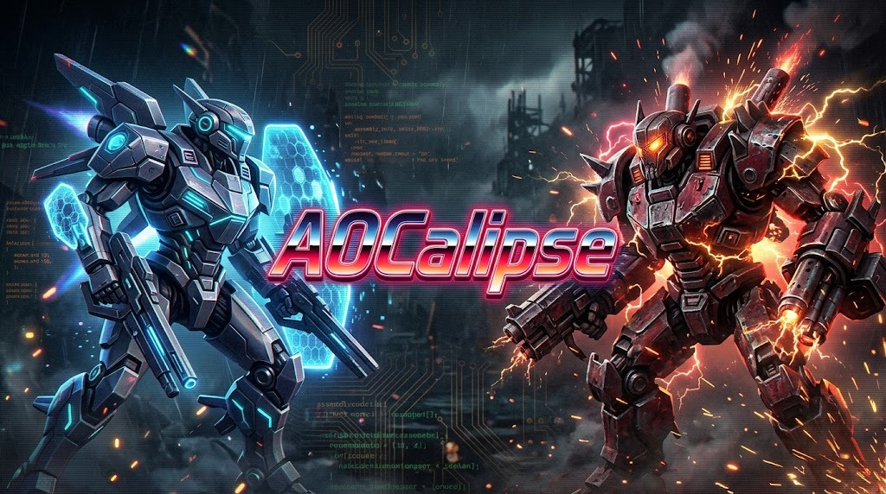

<h1 align="center"> 🚀 AOCalipse 🚀 <br>
  
  
</h1>

## 📖 Descrição do Produto


Inspirado na proposta de "Duelo de robôs por turnos", AOCalipse é um jogo tático de combate em turnos simultâneos para dois jogadores desenvolvido em assembly MIPS. Expandindo a ideia original cada competidor personaliza seu chassi com atributos distintos e gerencia seus níveis de energia. Além disso, o projeto introduz um sistema arriscado de Sobrecarga, no qual ultrapassar determinados limites de energia duplica tanto o dano causado quanto o recebido, trazendo profundidade estratégica e explorando mais instruções de baixo nível da arquitetura RISC.

---

## 👥 Integrantes

| Nome                          |   RA   | Email Institucional        |
| :---------------------------- | :----: | :------------------------- |
| Arthur Romano da Luz          | 168498 | arthur.romano01@unifesp.br |
| João Victor Assaoka Ribeiro   | 168863 | joao.assaoka@unifesp.br    |
| Felipe Gabriel de Santana     | 163713 | felipe.santana@unifesp.br  |
| Paulo Felipe Crot Ramos       | 169055 | paulo.crot14@unifesp.br    |
| Luís Felipe Salgado Mitidieri | 158555 | mitidieri.luis@unifesp.br  |

---

## 🛠️ Instruções de Execução
Pendente

---

## 🎮 Comandos de Interação

### 1. Seleção de Chassi (Início do jogo)
Cada jogador escolhe seu chassi digitando um número de `1` a `4`:

| Opção | Chassi              | Custo Ataque | Dano Ataque | Custo Defesa | Recarga |
| :---: | :------------------ | :----------: | :---------: | :----------: | :-----: |
|  `1`  | **Equilibrado**     |      4       |      8      |      2       |   10    |
|  `2`  | **Canhoneiro**      |      6       |     14      |      4       |    8    |
|  `3`  | **Tanque**          |      3       |      5      |      1       |   10    |
|  `4`  | **Reator Instável** |      5       |      9      |      3       |   16    |

### 2. Rodadas de Ação
A cada turno, o jogador ativo digita a sua ação secreta:
- `1`: **Atacar** — Consome `Custo_Ataque` de energia e causa `Dano_Ataque` ao oponente.
- `2`: **Defender** — Consome `Custo_Defesa` de energia e anula completamente qualquer dano recebido no turno.
- `3`: **Recarregar** — Sem custo; recupera `Recarga_Energia` pontos de energia.
- `0`: **Encerrar/Desistir** — Permite abortar a partida a qualquer momento de forma limpa.

### 3. Mecânica Especial: Sobrecarga (Overcharge)
- Se a energia do robô ultrapassar **40 pontos**, ele entra em estado de **Sobrecarga**.
- **Efeito:** Causa o dobro de dano em ataques e também recebe o dobro de dano de ataques sofridos.
- **Implementação em MIPS:** O cálculo do dobro é executado via shift binário para a esquerda (`sll $reg, $reg, 1`).

---

## ⚠️ Limitações Conhecidas
- Por rodar no terminal Run I/O do MARS, a ocultação de jogada secreta depende da emissão de caracteres de quebra de linha (`\n`), podendo ser rolada manualmente para cima caso o jogador quebre a regra de jogo limpo (fair play).
- O simulador não suporta threads reais; a simultaneidade é simulada por leitura sequencial das ações em buffer seguida do cálculo atômico de resolução da rodada.

---

## 📹 Link do Vídeo de Demonstração
- 🔗 **Vídeo no YouTube/Drive:** `[Link a ser adicionado após a gravação]`

---

## 📁 Estrutura do Repositório
```plaintext
Projeto-AOC/
├── README.md               # Apresentação geral, guia de execução e informações
├── Prompt.md               # Especificação e briefing original do trabalho
├── src/
│   └── main.asm            # Arquivo MIPS principal com o loop de jogo e procedimentos
└── docs/
    ├── ficha-tecnica.md    # Estruturas de dados, procedimentos e mapeamento de requisitos
    ├── testes.md           # 3 Casos de teste reproduzíveis detalhados
    └── uso-ia.md           # Registro de ferramentas, finalidades e verificações
```
